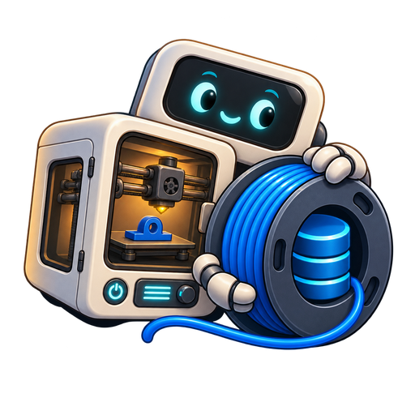

# PipSpool



**Spoolman synchronization for OrcaSlicer**

PipSpool turns every active [Spoolman](https://github.com/Donkie/Spoolman) spool
into a clear, individual OrcaSlicer filament profile. It keeps spool identity,
material, colour, manufacturer, temperatures and selected filament settings
synchronized—without performing a second filament deduction.

PipSpool is maintained by **Donko** and designed for printers where Klipper,
Moonraker, Happy Hare or another Spoolman integration already handles real-time
filament usage.

## Current release: 2.2.31

**Sync direction** now sits beside **Active spool G-code** in **Printer
Gates/Toolheads**. Both controls stay aligned as the dashboard narrows, and
**G-code** moves to the next line as a whole when its label wraps.

See the [changelog](CHANGELOG.md#2231---2026-11-13) for details.

## At a glance

- One OrcaSlicer filament profile for each active Spoolman spool.
- Stable spool-ID matching, so updates and renames do not create duplicates.
- Lifecycle-aware refreshes after supported Orca preset and project events, with
  a compatibility path for older Orca builds.
- Automatic removal of the matching profile when a spool is archived.
- Configurable profile naming, with `(#42) PLA Galaxy Blue - Manufacturer - PipSpool`
  retained as the default and a mandatory spool ID for safe matching.
- Nozzle temperatures imported from Spoolman; saved Orca bed temperatures kept
  by default, with an optional all-plate Spoolman override.
- Configurable spool-ID command with `{spool_id}` substitution, retaining
  `SET_ACTIVE_SPOOL ID={spool_id}` as the default, optional per-spool Start G-code,
  and the existing dashboard off switch.
- Optional synchronization for selected fields across every Orca filament tab.
- Per-run direction for selected advanced fields, with two-way sync by default.
  Review conflicting edits and choose a supported resolution in **Preview sync**.
- Shared Spoolman Filament values propagate across all associated physical-spool
  profiles without silently overwriting conflicting sibling edits.
- Native Spoolman field types and units for temperatures, percentages, numbers,
  booleans and supported choices.
- No slicer-side filament deduction and no duplicate process profiles.
- Five interface languages, automatic Orca language selection and a saved manual
  override.

## Synchronization choices

Save your changes in the numbered Orca filament profile and select the fields
you want to synchronize on the PipSpool dashboard. In **Printer
Gates/Toolheads**, set **Sync direction** beside **Active spool G-code**.

| Direction | What happens to selected advanced fields |
| --- | --- |
| **Two-way** | Eligible edits can move in either direction. This is the default. |
| **From Orca** | Eligible saved Orca edits update Spoolman and matching Orca profiles. |
| **From Spoolman** | Eligible Spoolman edits update Orca profiles without writing back to Spoolman. |

Use **Preview sync** to review the direction, planned profile changes, Spoolman
exports and supported conflict choices. Apply from the preview when ready.
PipSpool rechecks conflict choices against the current values and scope.
A field with changes outside the chosen direction may be skipped, including
its variants. The selector returns to **Two-way** after a dashboard sync.
Basic spool and profile sync follows your existing settings.

Enable **Create missing profiles only** in Settings to add new spool profiles
while skipping updates to existing profiles and advanced exports to Spoolman.

**Experimental tuning groups** can share selected advanced fields across matching
brands and materials. Product-name and colour matching start enabled and use
separate fields. If the Filament names include the colour, **Match product
name** can still separate them when **Match colour** is off. Clear both
options only when you want all spools of the matching brand and material to
share tuning. Differing existing Spoolman values require manual alignment
before those fields can be grouped. Each spool retains its own identity and
inventory.

## Bed temperatures

In **PipSpool Settings → Bed temperatures**, leave **Use Spoolman for all plates**
off to keep saved Orca values and inherit missing values from the profile's
portable material parent. This preserves different cool/hot plate temperatures
and any inherited zero that marks an unsupported plate. A portable parent may
differ from a printer-specific preset.

Turn the option on only when you want Spoolman's single Bed Temp applied to
every plate and both layer settings. To synchronize particular plates instead,
leave it off and select those advanced plate-temperature fields. Selected
advanced values and conflict protection take precedence in either mode.

Turning the option off does not remove earlier saved overrides. Restore any
previously flattened values manually in Orca using the appropriate material,
parent and extruder variant. Nozzle-temperature synchronization is unchanged.

## Experimental Bambu Studio export

Enable experimental Bambu Studio export in PipSpool Settings to add an export
action to each spool row. Supply an absolute path to a standalone Custom
Filament JSON saved in Bambu Studio's user preset folder for the same material
and exact printer/nozzle. Enter an output `.json` path in an existing folder.
Template tuning is kept; Spoolman's nozzle temperature is an optional,
range-checked override. The export keeps a stable identity for the same
Spoolman server, spool and target printer.

Import the JSON in Bambu Studio. PipSpool does not sign in to Bambu Cloud or
write directly to it. A same-name reimport may only update the local preset;
Bambu Studio's native edit/save was needed to queue a cloud update in local
testing. Cloud read-back and availability on the printer touchscreen remain
unverified. This feature is disabled by default.

## PipSpool dashboard

The integrated PipSpool page brings daily controls and useful information into
one place:

- Clear connection health with Happy or Sad Pip artwork.
- A saved theme selector beside **Feedback**, with built-in palettes and optional local wallpaper.
- Searchable active-spool overview with remaining weight, nozzle temperature and
  bed temperature.
- A compact **Columns** menu with saved visibility choices for Filament,
  Manufacturer, Colour, Nozzle, Bed and Remaining.
- Optional Gate/Toolhead and Profile status columns, plus direct spool-number
  links that open the corresponding Spoolman record.
- Optional searchable Spoolman Location column, hidden by default.
- Live-count filters for all, loaded, low-filament, synchronization-needed and
  profile-problem spools.
- Ascending or descending sorting by spool number, material, remaining weight,
  manufacturer and gate/toolhead.
- Sticky table headings that remain visible while scrolling through active
  spools.
- Colour-aware **Printer Gates/Toolheads** overview using assignments already
  reported by Spoolman.
- **Feedback**, **Refresh**, **Preview sync** and **Synchronize now**, plus a
  **Sync** button beside each active spool.
- An icon-only coffee-Pip support button beside **Feedback**, with a tooltip and
  keyboard focus indicator.
- A prominent **Active spool G-code** toggle that is enabled by default and removes
  PipSpool-managed spool-ID output, including the configured command, when switched off.
- A diagnostic pending-synchronization notice that identifies affected spools
  and changed fields, kept separate from the restart-required notice.
- Last synchronization metrics and a scrollable, collapsible report with visible
  errors and a persistent **Clear saved report** control. Clearing the report
  leaves profiles, synchronization baselines and restart requirements intact.
- A detailed change list showing which spool profiles and fields were updated.
- Optional page visibility without disabling PipSpool's core synchronization.
- Remaining-weight gauges, configurable low-filament warnings, duplicate-gate
  warnings and per-spool profile health on gate/toolhead tiles.
- Orca-style tabs for advanced Filament, Cooling, Multimaterial, Setting
  Overrides, Advanced, Dependencies and Notes fields.
- Deliberate cleanup controls for obsolete PipSpool fields.

Advanced field synchronization is opt-in. No advanced fields are selected by
default. Ordinary spool details, Spoolman nozzle temperatures and spool-ID
G-code work without enabling it. Bed temperatures follow the separate choice
in Settings. List-valued dependency settings such as Compatible
Printers and Compatible Prints retain their full values in both directions.

The coffee-Pip button opens Donko's support page in your system browser.
Opening or refreshing the dashboard does not contact Ko-fi. [Support PipSpool](https://ko-fi.com/gadonk)

## Interface language

Open **PipSpool Settings → Language** to choose **English**, **Deutsch**,
**Français**, **Español** or **Português (Brasil)**. The default, **Use OrcaSlicer
language (automatic)**, follows Orca's interface language when the host provides
it. Unsupported languages and older hosts without language information use
English. A manual choice is saved independently of Orca's language.

After saving, reopen PipSpool windows or use **Refresh** on the dashboard to apply
the language. Labels, dialogs and reports use bundled translations. Spool and
profile names, user-entered values, field identifiers, G-code, conflict identifiers,
selected values and exported diagnostic data retain their original content. Raw exception
details and technical examples can remain in English.

## Dashboard themes

Choose **PipSpool Classic**, **Light**, **Forest**, **Rosewood** or **Bonus Treat**
from the dropdown beside **Feedback**. Changes apply immediately and your
selection is remembered. Rosewood uses rich red surfaces and ruby actions;
Bonus Treat adds pumpkin-orange accents and matching Pip artwork. Loaded and
empty gate/toolhead cards follow the selected palette too, while filament colours
and remaining-weight gauges keep their meaning. Light theme uses readable
labels on matching light toolhead cards.

For a custom theme, open the dashboard once to create `example.json` in your
themes folder. Copy or edit that file to set colours and optional wallpaper
properties together in one JSON file. Put a referenced PNG, JPEG or WebP in the
folder's `images` subfolder, then click **Refresh**. Hover over the dropdown for
the exact folder path. Custom options show their JSON filename beside the name.

See the [theme guide](THEME_GUIDE.md) for default paths on every supported
platform, a complete example, image limits and sharing instructions. A
[starter theme file](themes/example.json) is also included. Themes change the
dashboard appearance; selecting a theme does not synchronize or rename profiles.

## Install and connect

### Orca Cloud

1. Subscribe to **PipSpool** in Orca Cloud.
2. In OrcaSlicer, open **File → Plugins**.
3. Select **Refresh**, then activate **PipSpool**.
4. Enter the complete address of your Spoolman server—for example,
   `http://192.168.1.50:7912`.
5. Select **Test connection**, then **Save settings**.
6. Open the **PipSpool** page and select **Synchronize now**.
7. Restart OrcaSlicer when the report says filament profiles changed.

### Manual installation

1. Download `pipspool-2.2.31-py3-none-any.whl` from the
   [latest GitHub release](https://github.com/Gadonk/pipspool-orcaslicer/releases/latest).
   The same wheel supports Windows x86-64, Linux x86-64, Linux ARM64, macOS Intel
   and macOS Apple Silicon. Select the wheel directly; do not unpack it or run pip.
2. Open **File → Plugins** in OrcaSlicer.
3. Choose **Install local plugin** and select the downloaded file.
4. Disable any previous locally installed PipSpool or development copy, then
   activate the new copy and follow the connection steps above. Local packages
   have their own Orca identity; only one PipSpool copy should be active.

The setup window opens automatically only when no valid settings have been
saved. It remains available through the dashboard's **Settings** button or PipSpool's setup action. PipSpool stores
critical user settings through Orca's supported capability configuration and
keeps its existing settings file as a compatibility mirror.

> Do not run PipSpool alongside another plugin that creates Orca profiles from
> the same Spoolman spools.

## How synchronization works

PipSpool matches generated profiles by numeric Spoolman ID. Adding, editing or
archiving a spool therefore updates the correct Orca profile instead of creating
another copy.

Generated profiles use this order by default:

```text
(#spool) MATERIAL Filament name - Manufacturer - PipSpool
```

### Synchronize one spool

Select **Sync** beside an active spool. It uses the dashboard's current
advanced sync direction. The checked scope follows Settings:
independent mode checks that spool; shared mode also reconciles its active
Filament siblings when advanced fields are selected; experimental tuning groups
check matching active spools across Filament records. Without a group or selected
advanced fields, only the chosen spool is checked. Preview and the report show
the affected scope.

Use **Synchronize now** for the full inventory and archived-profile cleanup.
Unrelated profiles remain unchanged.

### Choose the spool-ID command

Open **PipSpool Settings → Active spool G-code**. The default template is:

```gcode
SET_ACTIVE_SPOOL ID={spool_id}
```

PipSpool replaces `{spool_id}` with the physical Spoolman spool number when it
writes the filament profile. Spool #42 therefore gets `SET_ACTIVE_SPOOL ID=42`.
The template must be a single line containing `{spool_id}` exactly once. The
Settings example preview and **Reset command to default** help you check it.
The command is saved through Orca's capability configuration and the existing
settings-file mirror.

The right command depends on installed firmware and macros, not the printer
brand alone. The same examples are available beside the setting:

| Printer / firmware setup | Command or setting | Requirement |
| --- | --- | --- |
| Klipper + Moonraker + Spoolman | `SET_ACTIVE_SPOOL ID={spool_id}` | Install the macro from [Moonraker's Spoolman setup](https://moonraker.readthedocs.io/en/stable/configuration/#setting-the-active-spool-from-klipper). |
| Anycubic GoKlipper with an M555 Spoolman bridge | `M555 S={spool_id}` | Reported in issue #16; use only if your firmware or macro implements it. This is not a universal Anycubic command. |
| Klipper with a custom SET_SPOOL_ID macro | `SET_SPOOL_ID ID={spool_id}` | Your printer must define that macro with an ID parameter. This is not Moonraker's documented default. |
| Happy Hare / MMU managing active-spool selection | Turn **Active spool G-code** off | Use this when the configured MMU integration already selects the correct active Spoolman spool on tool changes. |
| Printer without a compatible Spoolman command | Turn **Active spool G-code** off | Continue using the printer's own filament-selection workflow; profile synchronization remains available. |

Per-spool Spoolman `start_gcode` remains an explicit override of the automatic
command and now supports literal `{spool_id}` replacement too. Other Orca or
Klipper expressions in that custom text are preserved, not evaluated by PipSpool.

The dashboard **Active spool G-code** switch still disables managed spool-ID
output. During synchronization PipSpool removes the managed block, filters the
configured/standard spool commands and token-bearing lines from its custom
managed text, and preserves unrelated user-authored Start G-code. Saving a new
command does not turn the switch back on. Advanced/shared Start G-code cannot
restore another spool's managed ID or defeat the off switch.

After saving or toggling, synchronize the affected profiles and restart
OrcaSlicer when prompted. Use full synchronization to apply the change to all
active profiles. Changing this setting does not execute a command on the printer
or configure the printer's macros.

### Choose your profile naming

Open **PipSpool Settings → Profile naming** and reorder these placeholders:

- `{spool_id}`: required exactly once; renders as `(#42)`.
- `{material}`: the Spoolman material.
- `{name}`: the filament name without a repeated leading material.
- `{vendor}`: the manufacturer.

The default format is `{spool_id} {material} {name} - {vendor}`. For example,
`{vendor} - {material} {name} {spool_id}` gives
`Prusament - PETG Galaxy Black (#42) - PipSpool`.

A live example and **Reset to default** are available. PipSpool always appends
` - PipSpool` and validates the format to keep spool identification unambiguous.
Saving the setting does not rename profiles immediately: synchronize to apply it,
then restart OrcaSlicer when prompted. Full synchronization applies the format
to all active spools. Existing profiles are matched by spool ID and renamed while
preserving unrelated Orca adjustments. Unreadable or mismatched existing files
are preserved with a visible error instead of being overwritten.

PipSpool preserves unrelated Orca-specific profile adjustments. Advanced-field
synchronization remembers the last agreed value so it can identify which side
changed. The dashboard direction limits which edits can be applied in that run.
If both sides changed differently, their values are preserved for review.
Use **Preview sync** to choose a supported resolution.

## Features I’m working on

These are active areas of investigation and improvement, not release promises:

- Reloading changed filament profiles inside OrcaSlicer without requiring a
  restart, if the evolving plugin API provides a safe supported method.
- More useful dashboard feedback and controls while keeping the page simple.
- Broader compatibility testing as OrcaSlicer's plugin API changes.
- Improving material-profile matching and advanced-field coverage based on
  real-world filament libraries.
- Refining cross-platform diagnostics based on Windows, Linux and macOS user
  feedback.

Suggestions and reproducible test cases are welcome in
[GitHub Issues](https://github.com/Gadonk/pipspool-orcaslicer/issues).

## Compatibility

PipSpool 2.2.31 supports Windows x86-64, Linux x86-64, Linux ARM64, macOS Intel
and macOS Apple Silicon. Use OrcaSlicer 2.5.0 or a compatible RC build for
consolidated permission requests and automatic background inventory loading.
Compatibility guards retain manual synchronization and the existing first-use
permission flow on older plugin-capable builds.

On supported hosts, the approval dialog can appear during plugin loading and combine the
settings-file read, background-thread access and saved Spoolman host. A fresh
installation has no saved server to declare; configuring and contacting that
server may therefore need an additional approval. Orca stores approved grants.
Restart persistence was confirmed locally on RC. Installation, restart and
update behavior for this release still need native Orca testing.

In OrcaSlicer 2.5.0, open **Plugins → Permissions** and select PipSpool to review
the saved Spoolman-host and background-thread access. After changing a grant,
retry the action. Older hosts use permission prompts. Only approve destinations
you trust.

Orca's host-based network permissions are documented in
[PR #16690](https://github.com/OrcaSlicer/OrcaSlicer/pull/16690).
A host grant covers the server's API paths and targetless network events.
Different destinations and external browser actions can require separate consent.

Linux/WebKit Settings-window reload recovery requires an Orca build containing
[PR #15737](https://github.com/OrcaSlicer/OrcaSlicer/pull/15737).
Earlier network-permission fixes are tracked in
[PR #16658](https://github.com/OrcaSlicer/OrcaSlicer/pull/16658).
Older Orca builds may lack these host-side fixes.

PipSpool distinguishes a denied network operation from a disconnected server.
If Orca refuses an attempt while posting an approval prompt, approve the trusted
request and repeat the action. Permission denial during field setup or shared
Filament reconciliation stops synchronization before profile writes and does
not save a new successful synchronization baseline. Requests that change data
are never automatically replayed. A new plugin identity or a different host may
legitimately require approval. PipSpool does not edit or bypass Orca's grants.

OrcaSlicer's Python plugin API is new and may change in future builds.

## Pressure advance and custom filament IDs

Under **Advanced field synchronization → Advanced**, select pressure advance and
its enable option, plus any adaptive pressure-advance options you use. Save the
selection and synchronize. Profiles with multiple extruder variants retain the
matching values through companion fields; conflicting shared-sibling edits are
preserved and reported. These fields are opt-in and do not configure your printer
firmware or calibrate pressure advance automatically.

Orca percentages, enum values and ramming text are decoded according to their
field types. Disabled nullable filament overrides stay disabled; if such an
override is present, PipSpool preserves that field across the shared group rather
than guessing or enabling it. Malformed data still produces a preservation warning.

A standalone profile with its own `filament_id` and empty or omitted `inherits`
keeps its root identity during synchronization. This avoids Orca replacing that
ID with a generic parent's ID. Spoolman spool-number matching and managed Start G-code are
unchanged. The actual Filament ID Fixer/U1 workflow and the reported macOS build
still need reporter confirmation; see issues #18 and #19 for remaining reports.

## Advanced setting scope and diagnostics

Open **Settings → Advanced settings → Share settings** to choose shared Filament
settings (the default) or independent settings for each spool. Shared mode propagates
selected values to sibling profiles using the same Spoolman Filament. Independent
mode stores selected values on each Spoolman spool. Returning to shared mode with
differing sibling values reports a conflict rather than choosing a silent winner.

### Per-extruder-variant values

Live values from Orca's plugin API are decoded from its serialized format before
comparison: comma-separated numeric vectors and quoted, semicolon-separated
string vectors. Quotes, escapes and embedded delimiters are preserved. Diagnostics
also identifies the source format and whether decoding succeeded. Malformed
live input is reported without overwriting the affected setting.

Orca profiles can contain multiple volumetric-speed and flow-ratio values, aligned
with their extruder variants. PipSpool preserves this mapping and synchronizes
changes to any variant. Reordering the list does not move a value to another
variant. Compatible changes to different variants merge; conflicting edits to
the same variant are reported and preserved.

Inherited variant changes are saved with their resolved layout. Missing,
ambiguous or changed-parent mappings preserve the affected values and explain
the conflict rather than guessing. After an import, repeated syncs protect
against Orca still exposing the preceding loaded value.

If saving an Orca profile fails, the affected fields keep their previous
baseline and block ambiguous outbound retries while unrelated successful
profiles can continue. Completed Spoolman writes are not rolled back; review
the report before retrying, and restart Orca when prompted to load saved presets.

Expand **Single values and per-variant values in Spoolman** in the dashboard or
plugin-menu selector for an explanation. Save the field selection or synchronize
to apply the updated Spoolman display names. Existing field keys, types, values,
defaults, units and ordering are preserved; incompatible field types are reported
without deletion or recreation.

For example, flow ratio appears as:

| Spoolman display name | Purpose |
| --- | --- |
| Filament: Filament Flow Ratio (single value / legacy) | One value for older profiles or when variants agree. It may be blank or retain an earlier value when variants differ. |
| Filament Flow Ratio (per-variant values) | The existing Text field containing the JSON map matched to extruder variants; authoritative when those values differ. |

A map containing `"legacy": null` has no retained single scalar value. Its
per-variant values can still be present and synchronized. Keep both fields.

Orca may save unchanged numeric/Boolean variant entries as `nil` placeholders.
PipSpool resolves these from a known parent by extruder/variant identity before
comparison, retaining explicit edits such as flow ratio 1.0053. Missing or
ambiguous parent mappings are preserved and reported. This is separate from
nullable filament retraction/ironing overrides, where `nil` means disabled and
must stay disabled. No manual profile edits or field deletion are required.

The original numeric Spoolman fields remain compatible. Additional Text fields
`orca_filament_max_volumetric_speed__variants` and
`orca_filament_flow_ratio__variants` store the versioned variant maps. Shared mode
stores these on the Filament; individual mode stores them on each spool. When
values differ by variant, the map holds those distinct values and the numeric
field remains a legacy scalar—it cannot represent six different values. Uniform
maps update the scalar too. Editing that scalar while a distinct map exists
reports a conflict rather than guessing which variant to change. Review the
mapping in Diagnostics and edit the intended Orca variant instead.

Malformed or ambiguous mappings are preserved and reported. You should not need
to manually clear arrays or edit profile JSON as part of normal synchronization.

Click **Diagnostics** to open a window matching the selected theme. Review the
anonymous numeric comparisons before exporting. Enter your chosen absolute path
and `.json` filename in an existing folder; the exact reviewed report is saved
there and existing files are preserved. The current Orca plugin API has no native
Save As picker, so export uses a path field. Nothing is sent automatically. Reports
omit raw logs, credentials, server addresses, paths, profile names, original IDs
and G-code. Collect reports before and after a suspected reset; after-only data
cannot recover the preceding values. Historical error logs are not included.

Opening the dashboard automatically reads the Spoolman inventory. On hosts with
the supported combined permission API, the read runs in the background. Spools
appear before profile checks finish. Responses from a previously configured
server are ignored so they cannot replace the current inventory or export data.

Older hosts and the explicit **Allow connection** action use a real read-only
request through Orca's UI callback so permission prompts can appear. That path
may pause the interface while the server responds or you answer a prompt.
Automatic attempts pause after a denial, and the connection panel distinguishes
network access from background-thread refusal. Review the permission, then retry
explicitly. Timing details remain in the local PipSpool log. Actual connection
times depend on the server and still need native Orca measurement.

## Privacy and release safety

Version 2.2.31 uses one universal wheel of about 4 MB, with bundled artwork and
five translation catalogs stored as separate local package resources. Interface
translation uses these bundled files without an external translation service.
Release workflows validate the wheel's metadata, file hashes, source, resources
and upload size before creating a draft or contacting Orca Cloud. Packaging does
not determine Orca Cloud's security rating; that rating comes from Orca Cloud's
own review.

PipSpool synchronizes with the Spoolman address saved in its settings. Its
installed-version notice also checks the public GitHub release API. The public
source defaults to `http://localhost:7912`; configure your actual server address
during setup. GitHub Actions rejects private development addresses from release
artifacts. The universal wheel is checked for valid Python syntax and complete
bundled artwork before release.

## License

PipSpool is maintained and copyrighted by **Donko** and distributed under the
[MIT License](LICENSE).

The PipSpool logo is original artwork based on Donko's Pip character and an
independently designed filament-spool/database motif. It does not reproduce the
official Spoolman logo or wordmark.

### Synchronization corrections in 2.2.15

Saved per-spool advanced values are preserved over live parent-preset defaults.
Only the matching live spool profile can override those effective values. Selected
fields still synchronize through the shared Spoolman Filament; conflicting sibling
edits remain preserved and reported, including nozzle and plate temperatures.
Pure Orca-to-Spoolman exports no longer request a restart from the manual sync
action. Imports into sibling profiles and other disk-profile changes can still
require a restart. The reporter has since described remaining sync-back failures
in some existing profiles; investigation continues in [issue #17](https://github.com/Gadonk/pipspool-orcaslicer/issues/17).
The new safeguards and diagnostics improve investigation of that follow-up; issue #17 remains open pending confirmation.
